# Prophecy graph

Generated by `scripts/build.py` from `data/prophecies.yaml`. Do not edit by hand.

Themes → source passages → New Testament fulfilment claims. Dashed edges link a Targum, Talmud or Qumran entry to the Tanakh passage it comments on. Green nodes are Jewish texts outside the Tanakh.

```mermaid
flowchart LR
    classDef theme fill:#2b2d42,color:#fff,stroke:none
    classDef heb fill:#fff3cd,stroke:#b8860b,color:#000
    classDef arc fill:#ffe8cc,stroke:#c2410c,color:#000
    classDef grk fill:#d7e3fc,stroke:#1d4ed8,color:#000
    classDef jew fill:#e8f5e9,stroke:#2e7d32,color:#000,stroke-dasharray:4 2

    subgraph Themes
        T_lineage[Lineage]:::theme
        T_covenant[Covenant]:::theme
        T_birth[Birth]:::theme
        T_forerunner[Forerunner]:::theme
        T_ministry[Ministry]:::theme
        T_suffering[Suffering]:::theme
        T_death[Death]:::theme
        T_resurrection[Resurrection]:::theme
        T_exaltation[Exaltation]:::theme
        T_kingdom[Kingdom]:::theme
    end

    subgraph Tanakh ["Tanakh (Hebrew / Aramaic)"]
        gen_3_15["Genesis 3:15<br/>ואיבה אשית בינך …<br/>The seed of the woman"]:::heb
        gen_12_3["Genesis 12:3<br/>ואברכה מברכיך ומקללך …<br/>All families blessed through Abraham"]:::heb
        gen_49_10["Genesis 49:10<br/>לא יסור שבט …<br/>The sceptre of Judah until Shiloh comes"]:::heb
        deut_18_15["Deuteronomy 18:15<br/>נביא מקרבך מאחיך …<br/>A prophet like Moses"]:::heb
        2sam_7_12_13["2 Samuel 7:12-13<br/>והקימתי את זרעך …<br/>David's throne established forever"]:::heb
        ps_22_17["Psalm 22:17<br/>כי סבבוני כלבים …<br/>They pierced my hands and feet"]:::heb
        ps_110_1["Psalm 110:1<br/>נאם יהוה לאדני …<br/>Sit at my right hand"]:::heb
        isa_7_14["Isaiah 7:14<br/>לכן יתן אדני …<br/>Born of the almah"]:::heb
        isa_9_5["Isaiah 9:5<br/>כי ילד ילד …<br/>Unto us a child is born"]:::heb
        isa_53_5["Isaiah 53:5<br/>והוא מחלל מפשענו …<br/>The suffering servant"]:::heb
        mic_5_1["Micah 5:1<br/>ואתה בית לחם …<br/>Ruler from Bethlehem"]:::heb
        dan_9_26["Daniel 9:26<br/>ואחרי השבעים ששים …<br/>An anointed one cut off"]:::heb
        zech_9_9["Zechariah 9:9<br/>גילי מאד בת …<br/>King riding on a donkey"]:::heb
        zech_12_10["Zechariah 12:10<br/>ושפכתי על בית …<br/>They shall look on him whom they pierced"]:::heb
        mal_3_1["Malachi 3:1<br/>הנני שלח מלאכי …<br/>The messenger who prepares the way"]:::heb
        ps_2_7["Psalm 2:7<br/>אספרה אל חק …<br/>You are my son"]:::heb
        ps_16_10["Psalm 16:10<br/>כי לא תעזב …<br/>You will not abandon my soul to Sheol"]:::heb
        ps_69_22["Psalm 69:22<br/>ויתנו בברותי ראש …<br/>Vinegar for my thirst"]:::heb
        isa_11_1_2["Isaiah 11:1-2<br/>ויצא חטר מגזע …<br/>A shoot from the stump of Jesse"]:::heb
        isa_40_3["Isaiah 40:3<br/>קול קורא במדבר …<br/>A voice crying in the wilderness"]:::heb
        isa_42_1["Isaiah 42:1<br/>הן עבדי אתמך …<br/>Behold my servant"]:::heb
        isa_49_6["Isaiah 49:6<br/>ונתתיך לאור גוים …<br/>A light to the nations"]:::heb
        isa_50_6["Isaiah 50:6<br/>גוי נתתי למכים …<br/>I gave my back to those who strike"]:::heb
        isa_61_1_2["Isaiah 61:1-2<br/>רוח אדני יהוה …<br/>The Spirit of the Lord is upon me"]:::heb
        jer_23_5_6["Jeremiah 23:5-6<br/>הנה ימים באים …<br/>A righteous Branch for David"]:::heb
        jer_31_31["Jeremiah 31:31-33<br/>הנה ימים באים …<br/>A new covenant"]:::heb
        dan_7_13_14["Daniel 7:13-14<br/>חזה הוית בחזוי …<br/>One like a son of man"]:::arc
        hos_11_1["Hosea 11:1<br/>כי נער ישראל …<br/>Out of Egypt I called my son"]:::heb
        zech_11_12_13["Zechariah 11:12-13<br/>ואמר אליהם אם …<br/>Thirty pieces of silver"]:::heb
        zech_13_7["Zechariah 13:7<br/>חרב עורי על …<br/>Strike the shepherd"]:::heb
        mal_3_23["Malachi 3:23<br/>הנה אנכי שלח …<br/>Elijah before the great day"]:::heb
    end

    subgraph Jewish ["Targum · Talmud · Qumran"]
        tg_isa_52_13["Tg Isaiah 52:13<br/>הא יצלח עבדי …<br/>Targum Jonathan names the servant as Messiah"]:::jew
        san_98b_name["Sanhedrin 98b<br/>משיח מה שמו …<br/>The Messiah's names, including the leper scholar"]:::jew
        suk_52a["Sukkah 52a<br/>חד אמר על …<br/>Messiah ben Joseph is slain"]:::jew
        4q521["4Q521 frag. 2 col. ii, lines 1, 8, 12<br/>כי השמים והארץ …<br/>The Messianic Apocalypse"]:::jew
    end

    subgraph NT ["New Testament (Greek)"]
        nt_Romans_16_20["Romans 16:20<br/>ὁ δὲ θεὸς τῆς"]:::grk
        nt_Galatians_4_4["Galatians 4:4<br/>ἐξαπέστειλεν ὁ θεὸς τὸν"]:::grk
        nt_Galatians_3_8["Galatians 3:8<br/>Ἐνευλογηθήσονται ἐν σοὶ πάντα"]:::grk
        nt_Acts_3_25["Acts 3:25<br/>Καὶ ἐν τῷ σπέρματί"]:::grk
        nt_Hebrews_7_14["Hebrews 7:14<br/>πρόδηλον γὰρ ὅτι ἐξ"]:::grk
        nt_Revelation_5_5["Revelation 5:5<br/>ἐνίκησεν ὁ λέων ὁ"]:::grk
        nt_Acts_3_22["Acts 3:22<br/>Προφήτην ὑμῖν ἀναστήσει κύριος"]:::grk
        nt_John_6_14["John 6:14<br/>Οὗτός ἐστιν ἀληθῶς ὁ"]:::grk
        nt_Luke_1_32_33["Luke 1:32-33<br/>καὶ δώσει αὐτῷ κύριος"]:::grk
        nt_John_20_25["John 20:25<br/>ἐὰν μὴ ἴδω ἐν"]:::grk
        nt_Matthew_27_46["Matthew 27:46<br/>Ηλι ηλι λεμα σαβαχθανι"]:::grk
        nt_Matthew_22_44["Matthew 22:44<br/>Εἶπεν κύριος τῷ κυρίῳ"]:::grk
        nt_Acts_2_34_35["Acts 2:34-35<br/>Εἶπεν κύριος τῷ κυρίῳ"]:::grk
        nt_Matthew_1_22_23["Matthew 1:22-23<br/>Ἰδοὺ ἡ παρθένος ἐν"]:::grk
        nt_Luke_2_11["Luke 2:11<br/>ἐτέχθη ὑμῖν σήμερον σωτὴρ"]:::grk
        nt_1_Peter_2_24["1 Peter 2:24<br/>οὗ τῷ μώλωπι ἰάθητε"]:::grk
        nt_Acts_8_32_35["Acts 8:32-35<br/>ἀρξάμενος ἀπὸ τῆς γραφῆς"]:::grk
        nt_Matthew_2_5_6["Matthew 2:5-6<br/>Καὶ σύ, Βηθλέεμ γῆ"]:::grk
        nt_Luke_21_6["Luke 21:6<br/>οὐκ ἀφεθήσεται λίθος ἐπὶ"]:::grk
        nt_Matthew_21_4_5["Matthew 21:4-5<br/>Ἰδοὺ ὁ βασιλεύς σου"]:::grk
        nt_John_12_14_15["John 12:14-15<br/>ἰδοὺ ὁ βασιλεύς σου"]:::grk
        nt_John_19_37["John 19:37<br/>Ὄψονται εἰς ὃν ἐξεκέντησαν"]:::grk
        nt_Revelation_1_7["Revelation 1:7<br/>καὶ ὄψεται αὐτὸν πᾶς"]:::grk
        nt_Mark_1_2_4["Mark 1:2-4<br/>Ἰδοὺ ἀποστέλλω τὸν ἄγγελόν"]:::grk
        nt_Matthew_11_10["Matthew 11:10<br/>οὗτός ἐστιν περὶ οὗ"]:::grk
        nt_Acts_13_33["Acts 13:33<br/>Υἱός μου εἶ σύ,"]:::grk
        nt_Hebrews_1_5["Hebrews 1:5<br/>Τίνι γὰρ εἶπέν ποτε"]:::grk
        nt_Acts_2_27["Acts 2:27<br/>οὐκ ἐγκαταλείψεις τὴν ψυχήν"]:::grk
        nt_Acts_13_35["Acts 13:35<br/>Οὐ δώσεις τὸν ὅσιόν"]:::grk
        nt_John_19_28_29["John 19:28-29<br/>ἵνα τελειωθῇ ἡ γραφή,"]:::grk
        nt_Matthew_27_34["Matthew 27:34<br/>ἔδωκαν αὐτῷ πιεῖν οἶνον"]:::grk
        nt_Romans_15_12["Romans 15:12<br/>Ἔσται ἡ ῥίζα τοῦ"]:::grk
        nt_Matthew_2_23["Matthew 2:23<br/>ὅπως πληρωθῇ τὸ ῥηθὲν"]:::grk
        nt_Revelation_22_16["Revelation 22:16<br/>ἐγώ εἰμι ἡ ῥίζα"]:::grk
        nt_Mark_1_3["Mark 1:3<br/>φωνὴ βοῶντος ἐν τῇ"]:::grk
        nt_John_1_23["John 1:23<br/>Ἐγὼ φωνὴ βοῶντος ἐν"]:::grk
        nt_Matthew_12_18["Matthew 12:18<br/>Ἰδοὺ ὁ παῖς μου"]:::grk
        nt_Matthew_3_17["Matthew 3:17<br/>Οὗτός ἐστιν ὁ υἱός"]:::grk
        nt_Acts_13_47["Acts 13:47<br/>Τέθεικά σε εἰς φῶς"]:::grk
        nt_Luke_2_32["Luke 2:32<br/>φῶς εἰς ἀποκάλυψιν ἐθνῶν"]:::grk
        nt_Matthew_26_67["Matthew 26:67<br/>Τότε ἐνέπτυσαν εἰς τὸ"]:::grk
        nt_Matthew_27_30["Matthew 27:30<br/>καὶ ἐμπτύσαντες εἰς αὐτὸν"]:::grk
        nt_Luke_4_18_21["Luke 4:18-21<br/>Πνεῦμα κυρίου ἐπ᾽ ἐμέ,"]:::grk
        nt_Matthew_1_1["Matthew 1:1<br/>Βίβλος γενέσεως Ἰησοῦ Χριστοῦ"]:::grk
        nt_1_Corinthians_1_30["1 Corinthians 1:30<br/>ὃς ἐγενήθη σοφία ἡμῖν"]:::grk
        nt_Luke_22_20["Luke 22:20<br/>Τοῦτο τὸ ποτήριον ἡ"]:::grk
        nt_Hebrews_8_8_12["Hebrews 8:8-12<br/>Ἰδοὺ ἡμέραι ἔρχονται, λέγει"]:::grk
        nt_Mark_14_62["Mark 14:62<br/>ὄψεσθε τὸν υἱὸν τοῦ"]:::grk
        nt_Matthew_28_18["Matthew 28:18<br/>Ἐδόθη μοι πᾶσα ἐξουσία"]:::grk
        nt_Matthew_2_15["Matthew 2:15<br/>Ἐξ Αἰγύπτου ἐκάλεσα τὸν"]:::grk
        nt_Matthew_26_15["Matthew 26:15<br/>οἱ δὲ ἔστησαν αὐτῷ"]:::grk
        nt_Matthew_27_9_10["Matthew 27:9-10<br/>Καὶ ἔλαβον τὰ τριάκοντα"]:::grk
        nt_Mark_14_27["Mark 14:27<br/>Πατάξω τὸν ποιμένα, καὶ"]:::grk
        nt_Matthew_11_14["Matthew 11:14<br/>καὶ εἰ θέλετε δέξασθαι,"]:::grk
        nt_Matthew_17_12["Matthew 17:12<br/>Ἠλίας ἤδη ἦλθεν, καὶ"]:::grk
        nt_Philippians_2_9["Philippians 2:9<br/>διὸ καὶ ὁ θεὸς"]:::grk
        nt_Matthew_11_4_5["Matthew 11:4-5<br/>τυφλοὶ ἀναβλέπουσιν καὶ χωλοὶ"]:::grk
    end

    T_lineage --> gen_3_15 & gen_49_10 & isa_11_1_2
    T_covenant --> gen_12_3 & 2sam_7_12_13 & jer_31_31
    T_birth --> isa_7_14 & isa_9_5 & mic_5_1 & hos_11_1
    T_forerunner --> mal_3_1 & isa_40_3 & mal_3_23
    T_ministry --> deut_18_15 & zech_9_9 & isa_42_1 & isa_61_1_2 & 4q521
    T_suffering --> isa_53_5 & isa_50_6 & tg_isa_52_13 & san_98b_name
    T_death --> ps_22_17 & dan_9_26 & zech_12_10 & ps_69_22 & zech_11_12_13 & zech_13_7 & suk_52a
    T_resurrection --> ps_16_10
    T_exaltation --> ps_110_1 & ps_2_7 & dan_7_13_14
    T_kingdom --> isa_49_6 & jer_23_5_6

    gen_3_15 --> nt_Romans_16_20
    gen_3_15 --> nt_Galatians_4_4
    gen_12_3 --> nt_Galatians_3_8
    gen_12_3 --> nt_Acts_3_25
    gen_49_10 --> nt_Hebrews_7_14
    gen_49_10 --> nt_Revelation_5_5
    deut_18_15 --> nt_Acts_3_22
    deut_18_15 --> nt_John_6_14
    2sam_7_12_13 --> nt_Luke_1_32_33
    ps_22_17 --> nt_John_20_25
    ps_22_17 --> nt_Matthew_27_46
    ps_110_1 --> nt_Matthew_22_44
    ps_110_1 --> nt_Acts_2_34_35
    isa_7_14 --> nt_Matthew_1_22_23
    isa_9_5 --> nt_Luke_2_11
    isa_53_5 --> nt_1_Peter_2_24
    isa_53_5 --> nt_Acts_8_32_35
    mic_5_1 --> nt_Matthew_2_5_6
    dan_9_26 --> nt_Luke_21_6
    zech_9_9 --> nt_Matthew_21_4_5
    zech_9_9 --> nt_John_12_14_15
    zech_12_10 --> nt_John_19_37
    zech_12_10 --> nt_Revelation_1_7
    mal_3_1 --> nt_Mark_1_2_4
    mal_3_1 --> nt_Matthew_11_10
    ps_2_7 --> nt_Acts_13_33
    ps_2_7 --> nt_Hebrews_1_5
    ps_16_10 --> nt_Acts_2_27
    ps_16_10 --> nt_Acts_13_35
    ps_69_22 --> nt_John_19_28_29
    ps_69_22 --> nt_Matthew_27_34
    isa_11_1_2 --> nt_Romans_15_12
    isa_11_1_2 --> nt_Matthew_2_23
    isa_11_1_2 --> nt_Revelation_22_16
    isa_40_3 --> nt_Mark_1_3
    isa_40_3 --> nt_John_1_23
    isa_42_1 --> nt_Matthew_12_18
    isa_42_1 --> nt_Matthew_3_17
    isa_49_6 --> nt_Acts_13_47
    isa_49_6 --> nt_Luke_2_32
    isa_50_6 --> nt_Matthew_26_67
    isa_50_6 --> nt_Matthew_27_30
    isa_61_1_2 --> nt_Luke_4_18_21
    jer_23_5_6 --> nt_Matthew_1_1
    jer_23_5_6 --> nt_1_Corinthians_1_30
    jer_31_31 --> nt_Luke_22_20
    jer_31_31 --> nt_Hebrews_8_8_12
    dan_7_13_14 --> nt_Mark_14_62
    dan_7_13_14 --> nt_Matthew_28_18
    hos_11_1 --> nt_Matthew_2_15
    zech_11_12_13 --> nt_Matthew_26_15
    zech_11_12_13 --> nt_Matthew_27_9_10
    zech_13_7 --> nt_Mark_14_27
    mal_3_23 --> nt_Matthew_11_14
    mal_3_23 --> nt_Matthew_17_12
    tg_isa_52_13 --> nt_Philippians_2_9
    4q521 --> nt_Matthew_11_4_5

    tg_isa_52_13 -.-> isa_53_5
    tg_isa_52_13 -.-> isa_42_1
    san_98b_name -.-> gen_49_10
    san_98b_name -.-> isa_53_5
    suk_52a -.-> zech_12_10
    suk_52a -.-> ps_2_7
    4q521 -.-> isa_61_1_2
```

## Reading the graph

- **Yellow**: Hebrew source text. **Orange**: Aramaic (Daniel 7).
- **Blue**: Greek New Testament text that claims fulfilment.
- **Green, dashed border**: a Targum, Talmud or Qumran text that reads a passage messianically, linked by a dashed edge to the passage it comments on.
- Open `web/index.html` for the interactive version with side-by-side text and word glosses.
