# Prophecy graph

Themes → Jewish source passages → New Testament fulfilment claims. Dashed edges mark where a classical Jewish source (Targum, Talmud, Qumran) also reads the passage messianically, so the dispute is "who", not "whether".

Rendered automatically on GitHub. To regenerate after editing `data/prophecies.yaml`, update this file by hand for now (script planned, see README roadmap).

```mermaid
flowchart LR
    classDef theme fill:#2b2d42,color:#fff,stroke:none
    classDef heb fill:#fff3cd,stroke:#b8860b,color:#000
    classDef grk fill:#d7e3fc,stroke:#1d4ed8,color:#000
    classDef jew fill:#e8f5e9,stroke:#2e7d32,color:#000,stroke-dasharray:4 2

    subgraph Themes
        T_lineage[Lineage]:::theme
        T_covenant[Covenant]:::theme
        T_birth[Birth]:::theme
        T_forerunner[Forerunner]:::theme
        T_ministry[Ministry]:::theme
        T_suffering[Suffering]:::theme
        T_death[Death]:::theme
        T_exaltation[Exaltation]:::theme
    end

    subgraph Tanakh ["Tanakh (Hebrew)"]
        gen3["Gen 3:15<br/>זרעה · seed of the woman"]:::heb
        gen12["Gen 12:3<br/>ונברכו בך · all families blessed"]:::heb
        gen49["Gen 49:10<br/>שילה · sceptre of Judah"]:::heb
        deut18["Deut 18:15<br/>נביא כמני · prophet like Moses"]:::heb
        sam7["2 Sam 7:12-13<br/>כסא ממלכתו · David's throne"]:::heb
        ps22["Ps 22:17 [16]<br/>כארי / כארו · pierced hands"]:::heb
        ps110["Ps 110:1<br/>שב לימיני · sit at my right hand"]:::heb
        isa7["Isa 7:14<br/>העלמה · Immanuel"]:::heb
        isa9["Isa 9:5 [6]<br/>ילד ילד לנו · child is born"]:::heb
        isa53["Isa 53:5<br/>מחלל מפשענו · suffering servant"]:::heb
        mic5["Mic 5:1 [2]<br/>בית לחם · Bethlehem"]:::heb
        dan9["Dan 9:26<br/>יכרת משיח · anointed cut off"]:::heb
        zech9["Zech 9:9<br/>רכב על חמור · king on a donkey"]:::heb
        zech12["Zech 12:10<br/>אשר דקרו · whom they pierced"]:::heb
        mal3["Mal 3:1<br/>מלאכי · my messenger"]:::heb
    end

    subgraph NT ["New Testament (Greek)"]
        rom16["Rom 16:20<br/>συντρίψει τὸν Σατανᾶν"]:::grk
        gal3["Gal 3:8<br/>ἐνευλογηθήσονται ἐν σοί"]:::grk
        heb7["Heb 7:14<br/>ἐξ Ἰούδα"]:::grk
        acts3["Acts 3:22<br/>προφήτην ὡς ἐμέ"]:::grk
        luke1["Luke 1:32-33<br/>θρόνον Δαυίδ"]:::grk
        john20["John 20:25<br/>τύπον τῶν ἥλων"]:::grk
        matt22["Matt 22:44<br/>κάθου ἐκ δεξιῶν μου"]:::grk
        matt1["Matt 1:23<br/>ἡ παρθένος"]:::grk
        luke2["Luke 2:11<br/>χριστὸς κύριος"]:::grk
        pet2["1 Pet 2:24<br/>τῷ μώλωπι ἰάθητε"]:::grk
        matt2["Matt 2:5-6<br/>Βηθλέεμ"]:::grk
        luke21["Luke 21:6<br/>λίθος ἐπὶ λίθῳ"]:::grk
        matt21["Matt 21:4-5<br/>ἐπιβεβηκὼς ἐπὶ ὄνον"]:::grk
        john19["John 19:37<br/>εἰς ὃν ἐξεκέντησαν"]:::grk
        mark1["Mark 1:2<br/>τὸν ἄγγελόν μου"]:::grk
    end

    subgraph Jewish ["Jewish messianic readings"]
        tg_onk["Targum Onkelos"]:::jew
        tg_jon["Targum Jonathan"]:::jew
        tg_pj["Targum Ps-Jonathan / Neofiti"]:::jew
        san98["Sanhedrin 98a-b"]:::jew
        suk52["Sukkah 52a"]:::jew
        qum["Qumran 4Q174 / 4Q175"]:::jew
    end

    T_lineage --> gen3 & gen49
    T_covenant --> gen12 & sam7
    T_birth --> isa7 & isa9 & mic5
    T_forerunner --> mal3
    T_ministry --> deut18 & zech9
    T_suffering --> isa53
    T_death --> ps22 & dan9 & zech12
    T_exaltation --> ps110

    gen3 --> rom16
    gen12 --> gal3
    gen49 --> heb7
    deut18 --> acts3
    sam7 --> luke1
    ps22 --> john20
    ps110 --> matt22
    isa7 --> matt1
    isa9 --> luke2
    isa53 --> pet2
    mic5 --> matt2
    dan9 --> luke21
    zech9 --> matt21
    zech12 --> john19
    mal3 --> mark1

    gen3 -.-> tg_pj
    gen49 -.-> tg_onk
    gen49 -.-> san98
    deut18 -.-> qum
    sam7 -.-> qum
    isa9 -.-> tg_jon
    isa53 -.-> tg_jon
    isa53 -.-> san98
    mic5 -.-> tg_jon
    zech9 -.-> san98
    zech12 -.-> suk52
```

## Reading the graph

- **Yellow**: Hebrew source text, with a key word in Hebrew.
- **Blue**: Greek New Testament text that claims fulfilment.
- **Green, dashed**: a pre-Christian or rabbinic Jewish source that already reads the passage of the Messiah.
- Passages with **no green edge** (Isaiah 7:14, Psalm 22, Daniel 9, Malachi 3) are the ones where Christian and Jewish readings diverge on *whether* the text is messianic at all. Those need the most careful `jewish_reading` and `notes` fields.
